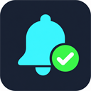

# Local Agent Completion Notifier



A VS Code extension that displays a native notification when a supported local agent turn ends. When the source process can be uniquely matched to an integrated terminal, the notification can switch back to that session.

## Supported providers

- **Codex CLI** through its user-level `notify` command.
- **Kiro CLI V3** through its user-level `Stop` hook.

The current supported environment is local Windows VS Code integrated terminals. External terminals, WSL, Kiro IDE chat, Kiro Web or cloud sessions, and Codex desktop conversations are outside the supported scope.

## Privacy and behavior

- Events contain provider and session identifiers, working directory, completion time, and source process IDs and creation times.
- Prompts, assistant replies, command lines, and environment variables are not stored.
- Pending events are stored in `%LOCALAPPDATA%\LocalAgentCompletionNotifier\pending`. A Codex event without a unique terminal match produces a general reminder after a short delay; other unmatched events expire after 10 minutes.
- A switch action is offered only when the source process uniquely matches an open VS Code integrated terminal. The extension never guesses another terminal, creates a terminal, or restarts a session.
- A completion notification does not indicate whether the agent's task succeeded.

## Install and configure

Install the VSIX in VS Code. Then clone or download the matching source version and run the provider setup helper from the repository root. The helpers copy the bridges to `%LOCALAPPDATA%\LocalAgentCompletionNotifier\bridge`, so they do not depend on the source repository remaining on disk after setup.

### Codex CLI

From the source repository root, run:

```powershell
powershell.exe -NoProfile -ExecutionPolicy Bypass -File scripts/install-codex-bridge.ps1
```

The installer copies a Node dispatcher and a PowerShell bridge to local app data, then prints a `notify` entry for the user-level Codex `config.toml`. Add that entry there. The dispatcher forwards to the installed Computer Use notifier when available and queues the VS Code event. If you use another custom `notify` command, arrange its forwarding separately before replacing it. Codex's `notify` setting is user-level; project-local configuration does not apply to notifications. See the [Codex configuration reference](https://learn.chatgpt.com/docs/config-file/config-reference).

### Kiro CLI

Run this command from the source repository root:

```powershell
powershell.exe -NoProfile -ExecutionPolicy Bypass -File scripts/install-kiro-hook.ps1
```

This installs the bridge under local app data and creates `%USERPROFILE%\.kiro\hooks\local-agent-completion-notifier.json`. Start a Kiro CLI V3 session. Existing V2 sessions are not converted. If the target hook already exists with different contents, the installer stops and preserves it.

If VS Code has not activated the extension, run **Developer: Reload Window**.

## Uninstall provider integration

Remove only the Kiro hook file created by this extension:

```powershell
Remove-Item -LiteralPath "$env:USERPROFILE\.kiro\hooks\local-agent-completion-notifier.json"
```

For Codex, remove this extension's `notify` entry from the user-level `config.toml`, while preserving other notification commands. The copied bridge and queued event files can be removed from `%LOCALAPPDATA%\LocalAgentCompletionNotifier` after VS Code and the agent CLIs are closed.

## Development

```powershell
npm ci
npm test
npm run package:verify
```

The verified VSIX is written to `release/local-agent-completion-notifier-0.3.1.vsix`.

## Event compatibility

The extension accepts legacy Codex v1 events and process-aware Codex v2 and Kiro v3 events. It validates provider-specific event data and fixed notification text before processing.

## Terminal focus

The extension matches the event's process ancestry against terminals in the current VS Code window. It offers a switch action only when exactly one terminal matches. Selecting the action focuses that VS Code window and terminal. A Codex turn without a unique match produces a general reminder without a switch action.
